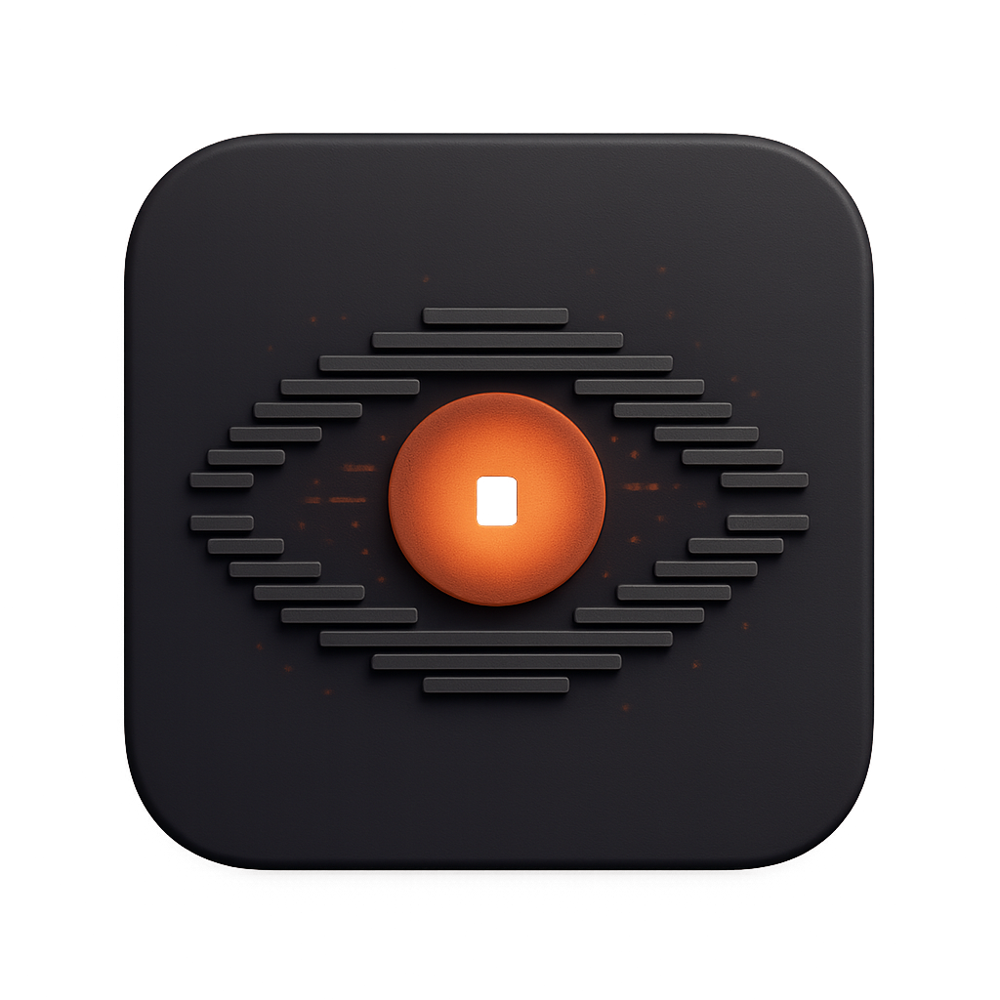
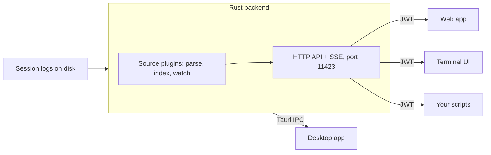

<p align="center">
  
</p>

# Claude Code Trace

[](https://github.com/delexw/claude-code-trace/actions/workflows/ci.yml)
[](LICENSE)
[](https://www.rust-lang.org/)
[](https://react.dev/)
[](https://v2.tauri.app/)
[](https://www.python.org/)
[](https://textual.textualize.io/)
[](https://github.com/delexw/claude-code-trace/releases)

**Claude Code Trace** is a viewer for the session logs Claude Code keeps on your machine
(`~/.claude/projects/*.jsonl`). It turns raw JSONL into a readable conversation, follows live
sessions as they run, and can score how efficiently an agent worked. It runs as a desktop app,
a web app, or a terminal UI, and nothing leaves your machine unless you ask for an analysis.

<p align="center">
  
</p>

## Features

- **Log viewer** — every session as a conversation, with expandable tool calls, thinking,
  tool results, sub-agents, token counts and timestamps. Edit tool calls show as word-level diffs.
- **Live tailing** — an open session updates as Claude Code writes to it, and the picker shows
  which sessions are still running.
- **Session picker** — sessions grouped by date and project, searchable by what you asked.
- **MCP tool calls** — `mcp__<server>__<tool>` calls get readable names, e.g. **MCP figma**.
- **Debug log and team views** — Claude Code's debug log and team task boards, when a session has them.
- **Efficiency analysis (optional)** — sends a redacted summary of a session to
  [Jev](https://typesafe.ai/) and shows trace-linked findings: repeated work, thrashing, recovery,
  token use. You see the exact payload and confirm before anything is sent.
- **Source plugins** — Claude Code is built in; other session sources can be switched on in
  Settings. See [Plugins](#plugins).
- **Three front ends** — desktop (Tauri), web, and terminal UI (Textual), all reading from the
  same backend.

## Plugins

Each session source is a plugin with its own folder on every part of the app. The picker, views
and settings show whatever the enabled plugins provide.

| Plugin      | What it reads                                                           | Default   |
| ----------- | ----------------------------------------------------------------------- | --------- |
| Claude Code | `~/.claude/projects/` session logs                                      | Always on |
| Antigravity | Google Antigravity "brain" conversations in `~/.gemini/<flavor>/brain/` | Off       |

Turn optional plugins on under **Settings → General → Sources**. With more than one on, the
picker gets an All / per-source filter. Antigravity conversations are read-only, and you can point
it at a different brain directory in Settings.

To add a plugin, see [specs/15-session-source-plugins.md](specs/15-session-source-plugins.md).

## Architecture



- One Rust backend parses and indexes the logs and watches the open session for changes.
  The desktop app talks to it over Tauri IPC. Everything else uses the local HTTP API, with a
  server-sent events stream for live updates.
- **Every HTTP caller is a registered client** holding its own HS256-signed JWT. The backend
  signs and checks the tokens itself and stores no credentials, only a list of clients so any one
  can be revoked or reissued without touching the others. The web UI (`web-ui`) and the terminal
  UI (`tui`) are registered automatically.
- A client sends its token in the `X-CCTrace-Token` header, an `Authorization: Bearer` header,
  a `?token=` query (used for the event stream), or a same-origin cookie.
- Jev and provider API keys live in the OS credential store (macOS Keychain, Windows Credential
  Manager, Linux Secret Service), never in the settings file.

Design notes for each part are in [specs/](specs/).

## Install

### macOS — one line

```bash
curl -fsSL https://raw.githubusercontent.com/delexw/claude-code-trace/main/script/install-macos.sh | bash
```

This installs **Claude Code Trace.app** into `/Applications`. Apple Silicon only. The app is
ad-hoc signed but not notarized; installed this way it opens straight away.

### Download

Get the latest build from [Releases](https://github.com/delexw/claude-code-trace/releases):

| Platform              | File                        |
| --------------------- | --------------------------- |
| macOS (Apple Silicon) | `.dmg`                      |
| Linux                 | `.deb`, `.rpm`, `.AppImage` |
| Windows               | `.msi`, `.exe`              |

The first time you open the downloaded macOS app, macOS says it can't verify it. Click **Done**,
then go to **System Settings → Privacy & Security** and click **Open Anyway**. On macOS 14 and
earlier you can right-click the app and choose **Open** instead.

### Build from source

Needs Rust (stable), Node.js 18+ and Python 3.11+ for the terminal UI. On Linux also install
`libwebkit2gtk-4.1-dev libayatana-appindicator3-dev librsvg2-dev libxdo-dev libssl-dev`.

```bash
git clone https://github.com/delexw/claude-code-trace.git
cd claude-code-trace
./script/install.sh       # builds everything and puts cctrace on your PATH
```

### Docker (web mode)

```bash
docker compose up --build   # then open http://localhost:1421
```

`./script/redeploy.sh` does the same and can store a Jev API key for the container.
See [docs/docker.md](docs/docker.md).

## Usage

```bash
cctrace              # desktop app
cctrace --web        # web app at http://localhost:1420
cctrace --tui        # terminal UI
```

Pick a session to open it. Click a message to expand it, or press `Enter` for the full detail
view. Press `?` in any view to see the keys.

### Efficiency analysis

1. Add your Jev API key: in the desktop app under **Settings → Analytics**; for web mode and the
   terminal UI, set `JEV_API_KEY` in the backend's environment.
2. Choose **Analyse efficiency** on a session (`a` in the terminal UI).
3. Check the redacted payload and confirm.

Results are cached per session and marked stale when the session changes.

### Calling the API

Add a client under **Settings → Accepted clients** and copy its token (shown once), or use the
terminal UI's token file:

```bash
curl -H "X-CCTrace-Token: $(cat ~/.config/claude-code-trace/clients/tui.jwt)" \
  http://127.0.0.1:11423/api/whoami
```

The config folder is `~/Library/Application Support/claude-code-trace` on macOS and
`%APPDATA%\claude-code-trace` on Windows. Set `CCTRACE_API_AUTH=off` to turn the check off.

## Development

```bash
npm install
npm run tauri dev        # desktop app with hot reload
npm run dev:web          # web app
npm run dev:tui          # backend + terminal UI
npm run check            # types, lint, format and all tests
npm run test:e2e         # Playwright, real backend + browser
```

Issues and pull requests are welcome. For bigger changes, open an issue first.

## License

[MIT](LICENSE)
